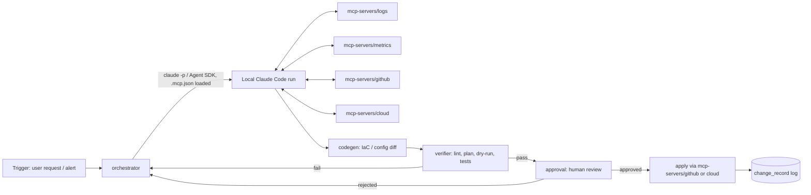

# AI DevOps Engineer Agent — Architecture

## Outcome this system moves

A daily-usable agent that takes a DevOps request in natural language (e.g. "the checkout service is throwing 500s, find out why and propose a fix" or "provision a staging Postgres instance") and produces a **verified, human-approved change** — IaC diff, config change, or remediation — with a trace of what it looked at and why. Measurable outcomes per phase are called out below; "it works" is not a phase-completion criterion.

## Correction to the original plan

Two things in the phase list you pasted need fixing before anything gets built, per your own global rules:

1. **LLM access.** Your CLAUDE.md rule is explicit: no OpenAI/Anthropic-API calls for agent reasoning — route through **local Claude Code**. Phases 2, 3, 5 as originally described (raw OpenAI API + Langchain) are out. See "LLM access" below for the replacement.
2. **"MCP" is Model Context Protocol**, not "Model-based Comms Protocol" — it's Anthropic's open standard for wiring an LLM client to external tools/data sources over a typed JSON-RPC interface. Claude Code is already an MCP client and can run its own agent loop against MCP servers. That changes the shape of Phases 2–4 substantially (next section).

## The real architectural decision — DECIDED: Option B

Claude Code is the agent runtime. It already provides a ReAct-style plan/act/observe loop, native MCP tool calling, subagents, hooks, permission gating, and skills. `orchestrator` drives it headlessly and owns only the DevOps-specific policy layer (what triggers a run, what gets logged, what needs human approval) rather than reimplementing a tool loop against a raw LLM API. Confirmed 2026-09-13.

## Confirmed invocation shape (verified against a live `claude --help` and two real headless runs, not guessed)

```
claude --print --output-format stream-json --verbose \
  --setting-sources project,local \
  --mcp-config <rendered .mcp.json> --strict-mcp-config \
  --permission-mode dontAsk --permission-prompts none \
  --no-session-persistence --max-budget-usd <cap> \
  --restricted \
  --system-prompt "<diagnostic-only persona>" \
  "<task description>"
```

Key flags and why:
- `--setting-sources project,local` — excludes the operator's personal `~/.claude/CLAUDE.md` and global rules from every run. Without this, a cold run pulls in ~18k tokens of irrelevant personal context (measured live) before it does anything DevOps-related. `--bare` would do this too but forces `ANTHROPIC_API_KEY` auth instead of the normal subscription session — wrong tradeoff here.
- `--strict-mcp-config` + `--mcp-config <rendered file>` — the run can only call the MCP servers `orchestrator` explicitly renders in for it, nothing from the operator's global MCP config.
- `--restricted` — strips Bash/PowerShell/code-execution tools and WebFetch. A diagnostic run has no business running shell commands; it only gets the registered MCP tools.
- `--permission-prompts none` — nothing can block waiting for a human in an unattended run; anything that would need a prompt is denied instead. Combined with `--restricted` and read-only MCP scopes, that's the actual safety boundary, not a permission dialog no one is watching.
- `--max-budget-usd` — hard spend cap per run, enforced by Claude Code itself (`terminal_reason: "budget_exhausted"` on a live test).
- `--model` intentionally omitted by default (`ClaudeRunConfig.model = None`) — let the account's configured default stand rather than hardcode a cheaper model. See `--model` docstring in `services/orchestrator/src/orchestrator/claude_runner.py`.
- `--output-format stream-json` over plain `json` — the single-result `json` mode only gives the final text and totals; `stream-json` also surfaces every `tool_use`/`tool_result` event, which `build_result()` turns into the audit-trail `ToolCall` list.

## Secrets never touch git or raw string interpolation

`.mcp.json.template` (committed) holds `${VAR}`-shaped placeholders only. `orchestrator.mcp_config.render_mcp_config()` parses it as JSON first, substitutes matching string *values* (not raw text) using a `SecretsProvider`, then re-serializes — a secret containing a quote or newline can't corrupt the config or inject a key. The rendered file is written to a temp path per run and is gitignored.

## Services-first layout

```
devops-agent/
  contracts/                    # shared schemas, versioned, both sides import — never reach into internals
    task_request.schema.json    # {id, description, requester, priority, created_at}
    tool_result.schema.json     # normalized shape every MCP tool server returns
    approval_request.schema.json
    change_record.schema.json   # what got proposed/applied, for audit + rollback
  services/
    orchestrator/                # owns policy: trigger -> Claude Code run -> approval -> apply
      src/
      tests/                     # gate: does it call the right MCP servers, enforce approval gate
      evals/                     # periodic: does the produced plan actually address the incident
      README.md
    mcp-servers/
      github/README.md            # registers github/github-mcp-server (official, read-only scoped) - no custom code
      cloud/README.md              # registers awslabs/mcp servers: cloudwatch, aws-iac (official) - no custom code
      logs/, metrics/, slack/       # build only when a concrete first use case needs them - see open question #2
    codegen/                     # Terraform/Dockerfile/config generation, invoked as a Claude Code skill or MCP tool
      tests/                     # gate: generated HCL/Dockerfile parses, lints clean
      evals/                     # periodic: generated IaC actually satisfies the request (LLM-judged)
    verifier/                    # static checks + test execution against generated changes before approval
      tests/
      evals/
    approval/                    # human approval workflow + audit log; the only service allowed to trigger apply
      tests/
    voice/                       # Phase 8, deferred — see "Deferred" section
  docs/
    ARCHITECTURE.md              # this file
  .mcp.json.template             # secret-free template; orchestrator renders real values in per-run
  scripts/                       # orchestration/glue only, no business logic
```

Each `services/*` directory is independently testable and independently deployable — two sessions can work in `mcp-servers/logs/` and `codegen/` without colliding, per your parallel-session rule.

## Data flow



## LLM access

`services/orchestrator` never calls an LLM API directly. It shells out to local Claude Code in headless `--print` mode with a rendered `.mcp.json` loaded, so Claude Code's own tool loop talks to your MCP servers directly — the orchestrator's job is choosing *when* to run, capturing the transcript for audit, and gating on `approval` before anything with side effects executes. Exact invocation flags are verified above, not guessed — see `services/orchestrator/src/orchestrator/claude_runner.py`.

## Phase mapping (original plan → this architecture)

| Original phase | Here |
|---|---|
| 1. Env setup | `services/orchestrator` + `mcp-servers/*` each get their own venv/deps, no shared global env |
| 2. ReAct loop | Provided by Claude Code itself (Option B) |
| 3. Agentic RAG | `mcp-servers/logs` + `mcp-servers/metrics` — Claude Code decides what to query, when, via native tool use |
| 4. MCP tool integration | `mcp-servers/github`, `mcp-servers/cloud`, `mcp-servers/slack` — real MCP servers, not custom adapters |
| 5. Codegen agent | `services/codegen`, invoked as a Claude Code skill/tool, not a separate OpenAI call |
| 6. Self-reflection/verification | `services/verifier` — deterministic lint/plan/test where possible (deterministic space), LLM-judged eval only where judgment is genuinely needed |
| 7. Human approval + deploy | `services/approval` — the only service with apply-time credentials |
| 8. Voice | Deferred — see below |

## Tests and evals (every service, no exceptions)

- **Gate tests** (free, <2s, pre-commit): schema validation for every MCP server's tool calls/responses against `contracts/`, codegen output lints/parses, orchestrator enforces the approval gate (unit test with a stub Claude Code run).
- **Periodic evals** (paid, nightly + pre-ship): does the agent's diagnosis match a labeled incident corpus, does generated IaC satisfy a rubric, judged by a Claude Code call — never a hosted API call for the judge either.

## Deferred: voice (Phase 8)

Lowest priority, no reason to design now. When it's time: OS-level STT/TTS (or a small local library) is enough for a wake-word + push-to-talk flow — no need for Alexa/Google Assistant platform lock-in for a personal DevOps tool.

## Decisions (2026-09-13)

1. **Option B confirmed** — Claude Code is the agent runtime.
2. **First tool integrations: GitHub + AWS cloud.** Logs/metrics next, Slack after that — build each when a concrete task actually needs it, not speculatively.
3. **Secrets** — production: a real secrets manager (Vault / AWS Secrets Manager / GCP Secret Manager), fetched just-in-time by `orchestrator`, never persisted by the agent. Local dev: env vars. Built now: the `SecretsProvider` protocol (`services/orchestrator/src/orchestrator/secrets.py`) and `EnvSecretsProvider` for local dev. **Not built yet**: a Vault/Secrets-Manager-backed implementation — there's no production deployment target to point it at yet, so it would be a speculative stub. Implement it against the same protocol when you pick a deployment target; that's a same-session addition, not a redesign.

## Phase 1 MVP — built (this repo, 2026-09-13)

- `contracts/` — 4 JSON schemas + `validate()`, 11 tests.
- `services/orchestrator/` — `SubprocessClaudeRunner` (verified CLI invocation, see above), `render_mcp_config` (safe secret substitution), `run_task()` (task → diagnostic Claude Code run → pending `ApprovalRequest`, never applies), 37 tests, all using a fake runner — no live LLM calls in the gate suite.
- `services/approval/` — `ApprovalStore` (append-only, enforces pending→decided exactly once) and `ChangeLog` audit trail, 10 tests.
- `.mcp.json.template` + READMEs registering the official `github-mcp-server` and two `awslabs/mcp` servers (`cloudwatch`, `aws-iac`) — no custom MCP server code written, per "search before building."
- 48 gate tests total, <1s, wired to a pre-commit hook (`git config core.hooksPath scripts/hooks`, done by `scripts/setup.sh`).

## Explicitly not built yet (next real increment, not this one)

- **An AWS write path.** AWS CloudWatch integration is read-only by design (see "Apply step — scope" below) — no concrete use case to build a write path against yet.
- **Vault/Secrets Manager integration.** See decision #3 above.
- **Voice (Phase 8).** Explicitly deferred in the original doc section below; nothing changed that.

(`services/verifier` and `services/codegen` were built and are validated — see their own sections below and `services/codegen/README.md` "Validated" for the live-tested Dockerfile happy path, 2026-09-17.)

## GitHub end-to-end validation (2026-09-13) — passed

Ran the real loop against a live throwaway repo (`ematobi1/AI-AGENT-DEVOPS-ENGINEER-MCP-AGENT`), staged deliberately in two passes so a failure couldn't be ambiguous between auth, transport, and orchestration:

- **Stage 1 (read-only PAT, Contents+Metadata read-only):** `orchestrator.run_task()` ran real Claude Code against the real `github-mcp-server` container, called `get_file_contents`, and produced a valid `ApprovalRequest`. $0.04.
- **Stage 2 (write-scoped PAT, Contents+Pull requests read/write):** a deliberate bypass of `run_task()` (see `WRITE_SYSTEM_PROMPT` in `scripts/smoke_test.py` — this is not the shipped apply path) created a branch, edited `README.md`, and opened a real PR. Independently verified after the fact via `gh pr view`/`gh pr diff` — not taken on the agent's own summary — confirming the diff was exactly the one line requested and nothing else (no merge, no delete).

Two real bugs found and fixed along the way, neither of them auth:
1. **`--allowedTools` is a variadic CLI flag** that greedily consumes every following bare argv token, including the task prompt itself, unless terminated with `--`. Reproduced cheaply against a trivial built-in-tool call before ever touching GitHub credentials. Fixed in `claude_runner.py._argv()`; regression-tested in `test_claude_runner_argv.py`.
2. **The public docs/READMEs for `github-mcp-server` were stale for the installed image version (v1.12.1).** `GITHUB_READ_ONLY`/`GITHUB_TOOLSETS` env vars are not read by this version — read-only and toolset restriction are CLI flags on the `stdio` subcommand (`stdio --read-only=<bool> --toolsets=...`). Found by pulling the real image and reading its actual `--help`, not by trusting search results. `.mcp.github-only.json.template` and `services/mcp-servers/github/README.md` reflect the verified behavior.

Also added `orchestrator.github_tools` — `GITHUB_READ_TOOLS`/`GITHUB_WRITE_TOOLS`, enumerated via a real MCP `initialize`/`tools/list` JSON-RPC exchange against the running server (not guessed), giving explicit allow/default-deny tool scoping as a second, independent layer on top of the server's own `--read-only` flag.

Environment quirks worth remembering for next time: Docker Desktop was not running by default on this machine and had to be started manually before the GitHub MCP server could be spawned — a prerequisite check worth automating if this becomes a recurring pain point. A `claude` CLI run can occasionally hang for the auto-mode-classifier reason surfaced as "Stage 2 classifier error... usually transient" — a retry resolved it in under 10s both times it happened; `ClaudeRunConfig.timeout_seconds` (default 300s) is what eventually surfaces this as a `ClaudeRunError` rather than hanging forever.

AWS remains out of scope until a separate validation pass, per the original decision to isolate one new variable at a time.

## AWS CloudWatch end-to-end validation (2026-09-13) — passed, one finding

Read-only only (this server exposes no write-capable tools at all, so there's no Stage 1/2 split like GitHub). Credential scoping mirrored the GitHub PAT discipline: a dedicated IAM user (`devops-agent-ro`) with only the AWS-managed `CloudWatchReadOnlyAccess` policy was created instead of reusing an existing, far broader `terraform-user` credential already configured on this machine — verified live (`sts get-caller-identity` resolves to the new user, `logs describe-log-groups` succeeds, `ec2 describe-instances` is denied) before anything ran.

`orchestrator.run_task()` ran real Claude Code against the real `awslabs.cloudwatch-mcp-server` process, called `describe_log_groups` and `get_active_alarms`, and produced a valid `ApprovalRequest` describing a real stack (`hotel-key-demo`, 17 microservices) in the account. $0.14.

One real discrepancy found by independently verifying the summary (same discipline as the GitHub PR check — never trust the agent's own numbers uncross-checked): it reported **87 log groups**; the true aggregated total, confirmed via raw `aws logs describe-log-groups` JSON, is **92**. `describe_log_groups` appears not to paginate through all results on an account with more log groups than fit in one page. Not a blocker for Phase 1, but recorded in `services/mcp-servers/cloud/README.md` — don't trust a count from this tool without cross-checking on a large account, and any real usage needs either an explicit "paginate through everything" instruction or an upstream fix.

Environment notes: unlike `github-mcp-server` (containerized via Docker), `awslabs.cloudwatch-mcp-server` runs as a plain local `uvx` process with no CLI flags at all — no `--help` output, no read-only/toolset restriction flags; it unconditionally registers all 19 tools (all inherently read-only by name/behavior — describe/get/analyze/query/list/recommend, nothing create/update/delete/put-shaped), so the read-only guarantee rests entirely on IAM plus `orchestrator.aws_tools.CLOUDWATCH_READ_TOOLS` (Claude Code's `--allowedTools`), not on the server. `uv`/`uvx` weren't installed on this machine; installed via `pip install uv` and added to the persistent user `PATH` — but a shell already open before that PATH update won't see it, and `claude` failing to spawn `uvx` as a bare command surfaces as a generic MCP "Connection closed," which looks exactly like an auth or transport failure but is actually just PATH staleness. Hit this live, diagnosed correctly, and worked around it per-invocation rather than assuming the integration itself was broken.

Also found and fixed a stale doc in this repo, not just upstream: `services/mcp-servers/cloud/README.md` previously recommended the broad `ReadOnlyAccess` managed policy (read access across nearly every AWS service) instead of the narrowly-scoped `CloudWatchReadOnlyAccess` actually used and verified here — corrected.

## Apply step — scope (v1, 2026-09-13)

Both integrations were validated before this was scoped: GitHub proved a real write path (Stage 2, above); AWS CloudWatch has no write-capable tools at all, so v1 apply is **GitHub only**. This isn't a placeholder decision to revisit soon — it's just where the only proven write path currently is.

**Decision: approve and apply are two separate, human-triggered actions, never one.** `ApprovalStore.decide(status="approved")` only records a decision — it has no side effect beyond that, and nothing in this codebase calls `apply_approved()` automatically. A human must separately run `scripts/apply.py <approvals-file> <approval-id> <changes-file>`, which itself prompts for a typed `apply` confirmation before doing anything. Two deliberate gates, not one, before a real write happens — the same shape as approve-then-deploy in most CI/CD setups, chosen over auto-apply-on-approval specifically so approving something now and applying it later (or not at all) are both possible, and so a mistaken approval isn't immediately irreversible.

**Design: `orchestrator.apply.apply_approved(approval, runner)` is integration-agnostic.** It doesn't know or care whether `runner` is wired to GitHub, AWS, or anything else — that's entirely determined by which MCP servers, credentials, and `allowed_tools` the caller builds the `ClaudeRunner` with. `scripts/apply.py` is where the GitHub-specific choice is actually made (`.mcp.github-only.json.template`, `GITHUB_WRITE_TOOLS`). This mirrors how `run_task()` is already integration-agnostic, and means a future AWS (or other) apply path is a new caller script, not a change to `apply.py` itself.

**Safety:** `apply_approved()` builds its prompt from the approval's `summary`/`proposed_actions` under `APPLY_SYSTEM_PROMPT` ("execute exactly this, do not expand scope, do not merge/delete, stop and report rather than improvise"), and the runner it's given uses `GITHUB_WRITE_TOOLS` — the exact allowlist already proven live in Stage 2 (create_branch, create_or_update_file, create_pull_request, plus read tools). `merge_pull_request` and `delete_file` are not in that allowlist, so Claude Code cannot call them here regardless of what the approved plan's text says — enforced at the tool-permission layer, not just by the prompt.

**Credential separation, same as the GitHub validation stages:** apply uses a write-scoped `GITHUB_PERSONAL_ACCESS_TOKEN`/`GITHUB_READ_ONLY_FLAG=--read-only=false`, distinct from whatever token a diagnostic `run_task()` call used. Never reuse a diagnostic read-only token for apply, or vice versa.

**Contracts:** `apply.py` never imports `services/approval` (and vice versa) — the `ChangeRecord` dict is the boundary. `scripts/apply.py` (glue, not a service) is the only place that imports both, reads an approval via `ApprovalStore.get()`, calls `apply_approved()`, and persists the result via `ChangeLog.record()`.

**Known gap, not addressed in v1:** `change_record.schema.json`'s `outcome` enum has no distinct state for "the apply run itself errored" (budget exhausted, tool denied) versus "verification found a problem" — there's no `services/verifier` yet to make that distinction meaningful, so both currently map to `failed_verification`. Revisit when verifier exists.

Not built, not scoped, not needed yet: auto-apply, an AWS write path, undo/rollback of an applied change (the change itself — e.g. a PR — is the undo mechanism for now: close it), and anything beyond the create-branch/edit-file/open-PR shape already proven.

## Apply step end-to-end validation (2026-09-13) — passed, one nuanced finding

Ran the full pipeline for real: `diagnose.py` → human review → `decide.py` (approve) → `apply.py` → real PR, on the same throwaway repo.

Found two real bugs immediately, both fixed same-session, neither of them in the design:
1. **Windows encoding crash.** `subprocess.run()` without an explicit `encoding=` decodes Claude Code's UTF-8 stdout using the host locale (cp1252 on Windows), raising `UnicodeDecodeError` on the first non-ASCII byte. Fixed with `encoding="utf-8", errors="replace"`. A related missing-guard bug (`proc.stdout` can come back `None` when this happens, and the code called `.splitlines()` on it unguarded) fixed alongside it.
2. **`decide.py` passed a raw `sys.argv` string straight to `ApprovalStore()`**, which called `.parent` on it and crashed — `ApprovalStore`/`ChangeLog` only ever got real `Path` objects from tests and other call sites, so this never surfaced until an actual CLI invocation hit it. Fixed the call site and hardened both constructors to accept `str | os.PathLike` so no future caller can repeat it.

The diagnostic run itself also surfaced a real prompt-quality bug before any of the above: its proposed actions included a literal bracketed placeholder (`[add other MCP operations being exercised, ...]`) and a separate "action" that was actually a question for the operator, not something executable. Fixed at the root — `SYSTEM_PROMPT` now requires every action to be complete and directly executable, with open questions confined to the summary. Considered and declined a schema-level `open_questions` field for this; it would solve with data modeling what was really an instruction-following gap.

**The apply itself:** the operator approved the pre-fix (flawed) proposal anyway, specifically to test whether `APPLY_SYSTEM_PROMPT`'s "execute exactly this, stop and report rather than improvise" guardrail would hold against a bad approved plan. What actually happened was a third path, not stop-or-blindly-paste: given the approved action literally said "confirm the actual list of MCP operations..." and the apply run had read tools available (`GITHUB_WRITE_TOOLS` includes `GITHUB_READ_TOOLS`), it treated "confirm" as something it could execute itself — it called read tools to inspect the repo's real history and used that to replace the placeholder with real content, rather than pasting the bracket text or refusing outright.

Independently verified via `gh pr diff` (never trust the run's own narrative — same discipline as every other validation in this doc): **the actual committed content was accurate and appropriately hedged** — capability categories ("read access... file contents, commit history, branches, and pull requests"), not overclaimed specifics. But the run's own *prose summary* claimed it had "confirmed" specific tool names (`list_commits`, `list_branches`, `list_pull_requests`) were historically exercised — a claim about which MCP tools produced a given git history that isn't actually derivable from the history itself, and wasn't verified. The artifact was fine; the stated methodology overclaimed certainty it didn't have.

**Takeaway for future, higher-stakes apply actions:** a capable agent given read tools alongside write tools will resolve an ambiguous "confirm/investigate" action via its own tool use rather than stopping, even when the literal instruction was written as something for a human to confirm. Fine for a low-stakes doc edit; would be exactly the wrong behavior for something like "confirm the current instance size" self-resolving into "pick a reasonable size" on real infrastructure. If a future apply target needs strict literalism, either keep read tools out of that runner's `allowed_tools` entirely, or add an explicit instruction: additional investigation beyond what the diagnostic run already found is itself a form of improvising and should stop-and-report, not execute.

## CI (2026-09-13)

`.github/workflows/ci.yml` runs all gate tests (pytest, deterministic, no network/secrets needed) on every push to `master` and every PR. Verified live via `gh run watch`, not just assumed from the YAML — first run passed in 20s.

## services/verifier — scope (v1, 2026-09-13)

Two checks, built sequentially against concrete need, not speculatively:

1. **`check_proposed_actions()` — built.** Deterministic, no LLM call, pattern-matches an `ApprovalRequest`'s `proposed_actions` for bracketed placeholders (excluding real markdown links via a negative lookahead so `[label](url)` isn't flagged), TODO/FIXME/TBD/PLACEHOLDER markers, and literal `?` characters. Directly motivated by the placeholder/question bug found during apply-step validation, above — this is a second, independent, deterministic layer that catches the same failure shape even if `SYSTEM_PROMPT` ever slips, rather than relying on prompt-following alone.

   Deliberately does **not** attempt to detect "this action is secretly a question" beyond the `?` signal — distinguishing a legitimate executable action from one that actually requires human judgment needs understanding what the action means, which is a latent-space judgment call, not a deterministic mapping. Forcing a regex to do that job would just trade one failure mode (an LLM writing a bad action) for another (a fragile heuristic misclassifying a good one). The real fix for that class of problem stays at the prompt level.

   Wired in at `scripts/diagnose.py`, not inside `orchestrator.run_task()` — same "services never import each other, glue scripts wire them together" pattern as `apply.py`. If verification finds anything, `diagnose.py` refuses to persist the `ApprovalRequest` at all: fail closed, so a known-bad proposal never reaches a human reviewer or `apply.py`.

2. **Post-apply diff verification — built (2026-09-13).** `scripts/verify_apply.py` extracts a PR reference from a `ChangeRecord`, fetches the real diff and state via `gh` (deterministic lookup by known PR number, not a judgment call — same reasoning as `orchestrator` shelling out to `claude`/`docker`), and checks two structural invariants: diff non-empty, no file deletion. Formalizes the manual `gh pr diff` checks done by hand throughout this document's earlier validation sections.

   Deliberately does not judge whether the diff's *content* matches the approved plan's *intent* — same latent-space reasoning as check #1's declined question-detection. If that judgment is ever needed it belongs in a periodic, LLM-judged eval with a pass threshold, not this gate check.

   **Caught a real design bug via live testing, not speculation:** the first version also flagged any PR state other than `OPEN`, reasoning that apply's tool allowlist (no `merge_pull_request`) should make anything else impossible. Ran it against the actual `ChangeRecord` from the earlier apply-step validation — PR #2, which the operator had since legitimately merged after review — and it produced a false positive: "PR is not open." A PR's terminal state is decided by subsequent human action, not by apply; there's no way to distinguish "apply somehow merged its own PR" (impossible given the allowlist, and not what happened) from "a human merged it later" just from current state. Removed the check rather than ship a false alarm on the normal, expected workflow. This is the same discipline as every other finding in this document: test against real data before trusting a design, and fix what testing actually reveals rather than what seemed reasonable on paper.

## services/codegen — scope (v1, Dockerfiles, 2026-09-13)

Operator-directed: `verifier` had two obvious candidates from real bugs already hit; `codegen` had none, so this was scoped by asking rather than guessing — the answer was Dockerfile generation.

**Design realization while scoping this:** most of the pipeline for "generate a file and get it approved/applied" already existed. The tightened diagnostic `SYSTEM_PROMPT` (from the apply-step validation, above) already required "write content out in full in the action itself rather than describing it," and `apply_approved()` was already integration-agnostic. So codegen's actual new surface area is narrow: a Dockerfile-specific generation prompt, extraction of a fenced code block (the existing numbered-list `_extract_proposed_actions()` parser isn't built for multi-line file content, so `scripts/generate_dockerfile.py` calls the runner directly and builds the `ApprovalRequest` itself — same "bypass `run_task()` when its contract doesn't fit" pattern as `smoke_test.py`'s write mode), and a deterministic lint check. `scripts/apply.py`/`apply_approved()` needed zero changes to execute an approved Dockerfile-creation action.

**Generation is genuinely latent-space** (writing a correct Dockerfile for an arbitrary repo requires understanding its language/dependencies/entry point) and goes through the local Claude Code runner like every other LLM call in this project — never a direct API call, never hand-rolled template logic pretending to be deterministic.

**Linting is genuinely deterministic**, and uses `docker build --check` rather than a new dependency (e.g. `hadolint`) — Docker was already installed and validated for `github-mcp-server`, and `--check` gives real syntax/best-practice validation via BuildKit without needing a new external tool. Verified live with three real cases before writing any parsing code: clean (exit 0, "no warnings found"), lint warnings (exit 1, `WARNING: <Rule> - <url>` blocks), and a genuine parse error (exit 1, `ERROR: dockerfile parse error...` — a different shape than a warning, parsed separately). All three captured verbatim as test fixtures.

**First live run found no bugs** — unlike every other validation in this document, which each caught at least one. Ran `scripts/generate_dockerfile.py` against the scratch repo (`AI-AGENT-DEVOPS-ENGINEER-MCP-AGENT`, which has no application code, only a README — a deliberate edge case). The model correctly refused to fabricate a Dockerfile rather than inventing a base image, package manager, and entry point out of nothing, citing the prompt's own "no placeholders, no invented specifics" instruction back as its reasoning. `extract_dockerfile()` correctly returned `None` (no labeled fenced block present), and the script correctly treated that as a controlled failure — printed the full response, exited non-zero — rather than crashing or proposing something ungrounded. Working exactly as designed on the first real try.

**Not yet validated:** the happy path (a real application repo with actual code, all the way through generation → lint-clean → verifier-clean → approve → apply → a real Dockerfile PR). Needs a real target repo with an actual entry point — the scratch repo can't exercise this by design. Do this once a concrete target is available, same "test against real data" discipline as everything else here.

## First happy-path attempt found a real verifier false positive (2026-09-13) — fixed

Ran `scripts/generate_dockerfile.py` against a real repo (a static site) for the first genuine happy-path attempt. Codegen's own output was good: unprivileged nginx, pinned base tag, non-root `USER`, a healthcheck, lint-clean. `verifier.check_proposed_actions()` blocked it anyway, flagging `CMD ["nginx", "-g", "daemon off;"]` — correct, recommended exec-form Dockerfile syntax — as a bracketed placeholder.

Three fixes, diagnosed precisely by the operator and implemented as specified:

1. **Narrowed the placeholder heuristic.** A bracketed span is only a placeholder if it fails to parse as JSON (excludes exec-form `CMD` arrays, Terraform lists, quoted YAML flow sequences — all valid JSON) *and* its content reads like prose instructions (starts with add/insert/replace/fill/todo/fixme/xxx/your, or contains "e.g."). Regression tests added for the exact nginx `CMD`, a Terraform list, and both quoted and unquoted YAML flow sequences.

2. **Structural fix, not just a narrower regex — the real root cause.** `ApprovalRequest.proposed_actions` items were plain strings, so `scripts/generate_dockerfile.py` had to embed the entire generated file inside one action string alongside its instruction, and the verifier's prose checks ran over both indiscriminately. Split each action into `{instruction, payload}`: `instruction` is prose and is checked; `payload` holds raw generated content (file contents, code, config) and is **never** prose-scanned, regardless of what it contains. This is a schema migration (`contracts/approval_request.schema.json`), touching `orchestrator.orchestrate._extract_proposed_actions()` (now emits `{"instruction": ...}` with no payload — its line-based parser was never built to capture multi-line payload content anyway), `orchestrator.apply.apply_approved()`'s prompt construction (now renders `payload` alongside `instruction` when present), `verifier.check_proposed_actions()` (now scans only `instruction`), and `scripts/generate_dockerfile.py`'s action construction. Makes the whole failure class impossible for any future bracket-using language, not just Dockerfiles — the actual point, per the operator: "otherwise this recurs for every bracket-using language we generate."

3. **Blocking → annotating.** `check_proposed_actions()` findings are no longer a reason to refuse persisting an `ApprovalRequest`. They're attached as `verifier_warnings` (a new optional schema field) and the request is persisted anyway; `scripts/decide.py` now fetches and prints any stored warnings before recording a decision, since that — not generation time, possibly a different session entirely — is when a human actually needs to see them. A false positive now costs a glance at decision time, not a discarded run. (The Docker lint check in `scripts/generate_dockerfile.py` is unrelated and unchanged — it validates the artifact itself via `docker build --check` and never produced a false positive here, so it still blocks on a genuine finding.)

Existing test fixtures across `contracts`, `orchestrator`, and `approval` updated for the new `proposed_actions` shape. `data/approvals.jsonl`/`data/changes.jsonl` (gitignored personal test data, not shipped) contain older records in the pre-migration string shape — harmless, since they're already-decided/applied history, not something that gets re-validated.

## Sample of 6 generations surfaced an architectural bug, not a stylistic one (2026-09-13)

After the verifier fix above, the operator held approval on the re-run and asked for a sample instead of trusting one data point: 4 more independent `generate_dockerfile.py` runs against the same real repo (a static site), for 6 total. Findings, and all 6 approvals rejected pending the fix below:

- **3 of 6 runs chose `nginxinc/nginx-unprivileged`** (non-root by construction). **3 of 6 chose plain `nginx`** and hand-rolled a rootless conversion via `sed` against the base image's own `/etc/nginx/nginx.conf`. This is an architectural/security-posture difference, not a formatting one — the model was re-deciding the container's privilege model independently every run.
- **Run 2 was actively unsafe:** `sed -i '/user\s*nginx;/d' /etc/nginx/nginx.conf` silently no-ops if the pattern doesn't match — no build failure, no error, nothing. **`docker build --check` passed all 6 runs, including this one.** It validates syntax and BuildKit's own best-practice rules, not architectural or security decisions — recorded plainly per the operator's instruction not to treat it as a safety oracle.
- **Run 3 used an unpinned tag** (`nginx:1.27`, missing the patch component) — passed lint too.

Three changes, built in the order specified — deterministic invariants first, prompt last, only for whatever the checks can't cover:

1. **Base image became a config input, not a generation decision.** `codegen.base_images.BASE_IMAGES` maps an operator-set `app_type` (currently just `static-site`) to one specific, fully-pinned image (`nginxinc/nginx-unprivileged:1.27.4-alpine`). `build_dockerfile_system_prompt(base_image)` replaces the old static `DOCKERFILE_SYSTEM_PROMPT` constant and injects that image as a non-negotiable directive — "do not choose, suggest, or substitute a different base image... even if you believe another choice would be better." `scripts/generate_dockerfile.py` takes a required `<app-type>` argument and resolves the image itself; the model no longer picks the security architecture. This removed the *reason* runs needed a hand-rolled `sed` conversion in the first place (the fixed image is already non-root), not just the symptom.

2. **Deterministic policy checks**, in `codegen.dockerfile.check_dockerfile_policy()` — placed in `services/codegen`, not literally inside `services/verifier`, since they require Dockerfile-domain semantics (parsing `FROM`/`HEALTHCHECK`/`CMD` structure) that don't belong in a package scoped to generic proposal prose; the architecture already draws this line (verifier = proposal shape, codegen = artifact-specific generation+lint). Flagged as an explicit judgment call in case a literal `services/verifier` placement was intended instead. Checks, all annotate rather than block, same discipline as `check_proposed_actions()`:
   - base image is in the configured allowlist (defense-in-depth even with #1's hard prompt constraint — trust but verify, same pattern as every other tool-permission boundary in this project)
   - tag is fully pinned to `MAJOR.MINOR.PATCH` (catches run 3's `1.27`)
   - an explicit `CMD` instruction is present
   - `HEALTHCHECK` is present with both `--retries` and `--start-period`
   - `sed -i` targeting a path under `/etc/` is flagged (catches run 2's exact pattern) — a heuristic, not a proof of brokenness, which is exactly why it annotates rather than blocks

   **Found a real regex bug writing the `HEALTHCHECK` check, caught by its own test suite before shipping:** the first version of `_HEALTHCHECK_BLOCK` used a greedy `.*` followed by a separately-optional continuation group (`.*(?:\\\r?\n.*)*$`). Since the continuation group could trivially match zero times and `$` (MULTILINE) matches at the end of line one anyway, the regex engine had no incentive to ever backtrack into matching a `\`-continued second line — a multi-line `HEALTHCHECK` (exactly the shape a real one takes, with `--retries`/`--start-period` on the continuation line) silently only matched its first line, missing the very flags the check exists to find. Fixed by making the continuation mandatory *within* each repetition (`(?:.*\\\r?\n)*.*$`) rather than a separate optional tail. Caught by a manual fixture-loading debug session, not by assuming the first version worked — the same discipline as every other bug in this document.

3. **`DOCKERFILE_SYSTEM_PROMPT`'s remaining stylistic guidance was deliberately left untouched this round** — per the operator's explicit sequencing ("only then look at the prompt, for what's left"), pending a fresh sample against the fixed base image and new checks to see what, if anything, still needs prompt-level guidance rather than a check.

## The fix applied one level further: CMD and HEALTHCHECK are also policy, not generation (2026-09-13)

The base-image fix above (4/4 correct in a follow-up sample) proved the pattern; it didn't finish the problem. Same 4-run sample showed CMD and HEALTHCHECK still regressing with the base image held fixed: 1/4 runs had a correct `CMD`, 1/4 had a correct `HEALTHCHECK`, no run had both. `check_dockerfile_policy()` caught and correctly annotated every case — the check layer worked exactly as designed; it was the generation layer still re-deriving something that shouldn't vary.

**Applied the operator's diagnosis directly: CMD and HEALTHCHECK are properties of the base image and how it's meant to run, not of the repo.** `codegen.base_images.AppImagePolicy` now carries `image`, `cmd`, `healthcheck`, and `port` together as one operator-configured unit. `codegen.dockerfile.render_dockerfile(policy, copy_instructions)` deterministically templates `FROM`/`EXPOSE`/`HEALTHCHECK`/`CMD` — the same policy and copy instructions always produce the same output, no LLM call involved. The model's job narrowed to exactly what the operator specified it should be: which files to `COPY`, where, and the `--chown` form — genuinely the only part that varies per repo, via a new, narrower `build_copy_instructions_prompt()` that explicitly forbids producing `FROM`/`CMD`/`HEALTHCHECK`/`EXPOSE` at all. `extract_copy_instructions()` requires the result to actually contain a `COPY` line, not just the right fence label — a model that followed the label but produced nothing usable is treated the same as producing no block at all.

**`check_dockerfile_policy()` needed zero logic changes** — it already operated on the final Dockerfile text regardless of source, so it now validates that `render_dockerfile()` itself assembled things correctly (a templating bug is still a bug) rather than that the model remembered. Added an integration test combining real `render_dockerfile()` output with real configured policy through `check_dockerfile_policy()`, asserting zero findings — proving the two fixes compose, not just that each passes in isolation.

The old full-Dockerfile prompt/extraction (`build_dockerfile_system_prompt`/`extract_dockerfile`) was deleted outright rather than kept alongside the new narrower path — it was demonstrably the source of the variance being fixed, and nothing else used it.

All four sample approvals rejected. Ready for a fresh 4-run sample against the fixed pipeline — expectation, per the operator, is zero warnings.

## Fresh sample clean (2026-09-14), but apply surfaced a third real bug — and a fourth

The fully-templated pipeline sampled clean: 4/4, zero warnings. The operator approved one (`dfaa9ef2`) and asked for the apply command. `apply.py` returned a 403 on `create_branch` — expected, since the write-scoped token hadn't been given access to the new target repo yet — but investigating it surfaced two more real, more serious problems before the token issue itself was even the point.

### Bug 3: `apply_approved()`'s outcome classification was wrong

The `ChangeRecord` for the failed attempt said `outcome: "applied"`. Its own `detail` field said the opposite — a 403 on `create_branch`, nothing written, the model correctly stopped and explained why rather than trying a workaround. The classification logic was `outcome = "applied" if not run_result.is_error else "failed_verification"` — but a model that hits a real failure and *gracefully explains it before stopping* produces `is_error: False` at the Claude Code run level, identical to genuine success. The audit trail this whole project has leaned on for independent verification was, in this exact case, wrong.

Fixed in `scripts/apply.py`, not `orchestrator.apply_approved()` — that function must stay integration-agnostic and has no way to know what "a successful write" means for an arbitrary integration. `apply.py` already knows it's GitHub-specific, so after a claimed "applied" outcome it now checks `verifier.find_pr_reference()` against the result text (a utility already built and tested for `verify_apply.py`) — a real GitHub apply always ends in a PR URL; if the outcome says applied but no PR URL appears anywhere, that's a contradiction, downgraded to `failed_verification` with a loud printed warning before persisting. Verified live against the actual mislabeled record's real detail text before considering it fixed, not just asserted. A corrective `ChangeRecord` was appended to `data/changes.jsonl` for the historical entry — append-only, the original wrong record is left in place, not edited.

Separately: `ApprovalStore.decide()`'s exactly-once guard correctly refused to let `dfaa9ef2` be re-decided once approved. Given nothing was ever actually applied under it (confirmed via the change record before the correction), leaving its status as `approved` is historically accurate and operationally harmless — nothing will ever call `apply.py` on that id again once a corrected proposal supersedes it. No change made to `ApprovalStore`'s decision model; revisit only if retroactively revoking an approved-but-unapplied decision becomes a recurring, not one-off, need.

### Bug 4: the generated Dockerfile was structurally clean and functionally incomplete

Every sampled run (across all fixes so far) produced `COPY index.html styles.css script.js <dest>` — a hand-picked file list. `index.html` references `images/profile-pic.jpg` and `images/project1-img.jpg`; the `images/` directory was never copied. Lint passed. All four policy invariants passed. A real `docker build` would have succeeded. The resulting container would serve a page with broken images.

**Root cause:** `build_copy_instructions_prompt()` asked the model to determine "which files or directories" to copy, and it defaulted to enumerating top-level files rather than walking the tree — the wrong framing for a static site, where the correct answer is almost always "copy the whole site directory," not a curated list. Fixed by rewriting the prompt to explicitly forbid enumeration and require a single `COPY` instruction for the entire identified site directory, spelling out why (subdirectories like `images/` won't be visible from a top-level-only listing, and a hand-picked list silently drops whatever wasn't named).

**Added a deterministic backstop**, same pattern as every other prompt fix in this document: `check_dockerfile_policy()` now flags a `COPY` with more than one source, or a single source that looks like a specific file (has an extension) rather than a directory — heuristic, not proof (a genuinely single-file app's `COPY` would also match), so it annotates. Regression test reproduces the exact real case (the three-file enumeration that omitted `images/`).

### A different class of problem, recorded per the operator's request, not solved

Lint validates syntax. Policy checks validate architectural/security invariants that hold *regardless of which app* is being containerized (pinned tags, an allowlisted base image, a real healthcheck). Neither one, and nothing built so far, can know whether the copied content is *complete with respect to what this specific app needs* — that requires knowing what the app actually references, which is inherently content-specific, not a universal rule. The heuristic added for bug 4 is a narrow, static-site-specific stopgap for one failure shape (enumeration), not a general completeness check, and it would not catch, for example, a whole-directory `COPY` that still missed an asset living outside the identified site directory.

Two genuinely different approaches exist for real completeness verification, neither built:

1. **Static cross-reference.** Parse the app's own source (e.g., every `src=`/`href=` in `index.html`, every `url()`/`@import` in CSS) for referenced paths, fetch the actual repository tree, and confirm every reference resolves to something that would land inside the `COPY`'s source directory. Fully deterministic given the inputs, but requires the check to run somewhere with live repo access (not just the final Dockerfile text) — a different shape of check than anything in `services/codegen` today, closer to a second investigation step than a text-pattern check.
2. **Dynamic verification.** Actually build the image (not just `--check`) and run it, then crawl the exposed port for 404s against whatever the entry page references. Tests real end-to-end behavior, not an inference from source, at the cost of an actual build+run+network round trip per candidate Dockerfile.

Neither is scoped or built. Worth deciding between them (or whether either is worth the cost) before generating anything with a real build step or a deeper asset graph than a flat static site — a compiled app, a framework with its own asset pipeline, or anything where "copy everything" stops being the obviously-correct default.

## CLI-shaped app type, and the full happy path finally validated live (2026-09-17)

The remaining gap from the previous section — "anything where 'copy everything' stops being the obviously-correct default" — arrived immediately: the operator picked `ematobi1/devops-agent` itself as the target, a 5-package monorepo (`contracts` + 4 `services/*`, each with its own `pyproject.toml`, no root requirements file) with no HTTP server at all, just CLI scripts. Neither existing assumption held: `static-site`'s policy is service-shaped (`EXPOSE`/HTTP `HEALTHCHECK`, zero build step), and this repo is CLI-shaped (no port, and genuinely needs a build step — installing five local packages — which the templating had no slot for at all).

**Design decisions, in order of how the gap was found:**

1. `AppImagePolicy.healthcheck`/`.port` became optional — a CLI app has no listening port to poll; forcing an HTTP `HEALTHCHECK` against one would template a meaningless instruction. `render_dockerfile()` omits the line rather than emitting a broken one.
2. A second generation capability, `needs_install_step`, was added alongside `COPY`: a two-block prompt (`\`\`\`dockerfile-copy` + `\`\`\`dockerfile-run`) asks the model for install instructions too, since which package manifests exist and how they relate is genuine per-repo variance, same reasoning as `COPY` itself.
3. A new app-type entry, `devops-agent-cli`, was added **scoped to this repo specifically** (`cmd=["python", "scripts/diagnose.py"]`), not as a generic "any Python CLI app" claim the way `static-site` genuinely is generic for any nginx-served site — a CLI app's entrypoint script is inherently repo-specific, and reusing this entry for a different CLI repo would silently run the wrong script.

**Two more real bugs, found the same way bug 4 (above) was found — by actually building and running the image, which `docker build --check` and the policy checks both cannot do, since neither executes anything:**

- **Bug 5:** a plausible model-style `RUN pip install -e ./contracts` resolves relative to Docker's default `/` working directory, not wherever `COPY` put the files — silently fails at real `docker build` time with no signal from `--check` or policy. Fixed by making `workdir` operator policy too (`WORKDIR` templated, matching the fixed `COPY` destination the prompt now specifies), and `AppImagePolicy.__post_init__` now raises immediately if `needs_install_step=True` without a `workdir` — this can't silently regress into the same bug for a future CLI-shaped type.
- **Bug 6:** `python:slim` (unlike `nginx-unprivileged`, chosen specifically for its built-in non-root user — see the base-image fix above) ships no non-root user at all. A model-style `COPY --chown=app:app` silently no-op'd against a user that didn't exist yet, and the container ran as **root** with zero lint or policy findings. Fixed by making privilege drop operator policy for this type too (`user`): `render_dockerfile()` now templates `RUN useradd` + `USER` *after* the install step (which needs root to write into the image's system Python) and *before* `CMD`, and the prompt no longer asks the model for a `--chown` on this app type at all, closing the gap at its source rather than only backstopping it.

**Full pipeline then run for real, live, no shortcuts:** `generate_dockerfile.py` against the real GitHub repo ($0.1536, read-only PAT) → lint clean, zero verifier/policy warnings → the model's own generated Dockerfile independently confirmed with a real `docker build` + `docker run` (non-root uid 1000, all 5 packages import cleanly, correct `CMD` behavior) *before* approving → `decide.py` approve → `apply.py` (write-scoped PAT) → real PR opened (`ematobi1/devops-agent#1`) → `verify_apply.py` clean → diff read manually, matched exactly → merged → pulled locally → rebuilt and relaunched from the actual merged file, same result. Zero code changes were needed once bugs 5 and 6 were fixed — the model chose a different (also correct) install order than the manual sanity-check Dockerfile that surfaced the bugs.

This closes the "not yet validated: a fresh sample against the fully-templated pipeline... and the full path through to an applied PR" note from the previous section, and the "AWS apply: not built" line above is now the only remaining item from the original Phase 1 gap list — everything else that section named is built and live-validated.

## `ui/` web frontend, and a real cross-platform bug it surfaced (2026-09-17)

A thin FastAPI/vanilla-JS local UI (`ui/`) was added over the same
pipeline scripts — `subprocess.run()` wrappers plus stdout parsing, no
pipeline logic duplicated. See `ui/README.md`'s own "Deviations from the
spec" section for six places its build prompt assumed a pipeline shape
(separate lint/verify scripts, a `--repo`/`--app-type` flag CLI, an
auto-apply-on-checkbox flow, a local-filesystem `repo_path`) that didn't
match what's actually in this repo, and how each was reconciled against
the real thing rather than guessed.

**A real, previously-latent bug, found only because the UI exercises a
new execution mode:** running the full pipeline live through the browser
against `ematobi1/kreative-website` (a genuine, never-before-touched
static-site target — chosen after `ematobi1/devops-agent` correctly
self-refused a second identical-content PR, see below) crashed
`scripts/apply.py` with `UnicodeEncodeError` on its own final
`print(outcome.run_result.result_text)`, mid-way through a real,
already-executed apply. Root cause: on Windows, `print()` to a *piped*
stdout (subprocess capture — the UI's execution mode; never exercised by
the interactive CLI's own runs) still encodes using the console's cp1252
codepage by default, not UTF-8, and the run's result text contained a
character (`→`) outside it. This is the same class of bug already fixed
once in this project (`claude_runner.py`'s *decoding* of a subprocess's
stdout, see "Apply step end-to-end validation" above) — never fixed for
a script's own *encoding* of its output until now. Fixed identically in
every script that prints Claude-generated text
(`apply.py`, `generate_dockerfile.py`, `diagnose.py`, `decide.py`,
`smoke_test.py`, `smoke_test_aws.py`): `sys.stdout.reconfigure(encoding="utf-8",
errors="replace")` / same for `stderr`, first line of `main()`.
Re-verified live after the fix: the next real attempt against the same
target produced a clean, readable error (a genuine `403` — see below),
not a crash.

**Two more live outcomes, both correct behavior, not bugs:**

- Against `ematobi1/devops-agent` (`devops-agent-cli`), the model
  independently discovered the `Dockerfile` already existed with
  byte-identical content (from the earlier session's merge) and refused
  to fabricate a no-op PR, explicitly asking for guidance instead of
  improvising. `apply.py`'s own outcome-contradiction check (no PR URL in
  a claimed-"applied" result — see "Fresh sample clean" above) correctly
  downgraded this to `failed_verification` rather than a false success.
- Against `ematobi1/kreative-website`, generate/lint/verify succeeded
  (read scope was granted), but apply correctly reported a real `403 -
  Resource not accessible by personal access token` when write scope
  wasn't — exactly the "surface the exact error, don't swallow it"
  behavior the UI's own spec called for, proven with a genuine permission
  gap rather than a synthetic one.

Both are additional live proof of behavior already designed and tested
earlier in this document (the outcome-contradiction check; verifier
findings annotate, never block) — recorded here because they happened to
be *found* by this session's UI testing, not because anything changed
about how they work.

## Kubernetes/Terraform codegen scaffolding (2026-09-17) — explicitly not fully implemented

Requested as a deliberate exception to this project's own build-against-
something-real discipline: policy dataclasses and their deterministic
checkers only, sketched and documented, with no generation prompt, no
script, and no orchestrator wiring — because there is no real cluster or
Terraform-managed target to validate any of that against yet, the same
reason `K8S_POLICIES`/`TERRAFORM_POLICIES` are deliberately empty tables
rather than a first speculative entry (a tripwire test on each asserts
this — see `services/codegen/tests/test_kubernetes_policy.py`/
`test_terraform_policy.py`). Every real fix in the Dockerfile codegen
history above came from testing against something real; building the
generation/orchestrator layer for these two before a real target exists
would be exactly the kind of speculative work that history argues
against. Do not add a script or a generation prompt for either until a
concrete target shows up — extend the pattern below against that target,
the same way `devops-agent-cli` was added against a real repo rather than
a hypothetical "any Python CLI app."

**What's real:** `services/codegen/src/codegen/kubernetes_policy.py` and
`terraform_policy.py` — `KubernetesManifestPolicy`/`TerraformConfigPolicy`
dataclasses (the same operator-fixes-what-shouldn't-vary split as
`AppImagePolicy`: allowed resource kinds/types, required `apiVersion` per
kind, namespace, required labels/tags, pull policy, whether resource
limits are mandatory, a required Terraform provider, hardcoded-secret
detection) and `check_manifest_policy()`/`check_terraform_policy()` —
ordinary, tested, deterministic Python, ready to use. Kubernetes
validation parses real YAML (PyYAML — genuinely structured data, unlike a
Dockerfile); Terraform validation is regex-based like
`codegen.dockerfile`'s own Dockerfile checks, not a full HCL parser (no
real `.tf` file exists yet to prove a heavier dependency is even
warranted).

**What a generation prompt would eventually narrow the model to** (not
built): the same "operator policy templates everything that shouldn't
vary, the model fills in only what genuinely varies per target" shape as
`build_generation_prompt()` — for Kubernetes: resource name, container
image reference/tag, replica count, container port, env var *names* (never
secret values); for Terraform: resource names/arguments specific to the
target, never provider blocks, never tag policy, never anything that
should come from `required_tags`/`allowed_resource_types`.

**Sketch of the integration points** (prose only — nothing below exists
in code, and none of it should until a real target justifies it):

- **Diagnostics** (`orchestrator`/`scripts/diagnose.py`): would need a
  narrow, separate system prompt (like `build_generation_prompt()`, not a
  reuse of the numbered-action-list `SYSTEM_PROMPT`) asking the model to
  identify a *concrete* Kubernetes/Terraform opportunity or problem in a
  target repo/cluster — mirrors how `generate_dockerfile.py` doesn't reuse
  `run_task()` because its extraction shape doesn't fit a single
  multi-line artifact.
- **Decision** (`ApprovalRequest.proposed_actions`): a proposal to
  generate or modify a manifest/config would carry the same
  `{instruction, payload}` shape codegen already uses for a Dockerfile —
  `payload` is the raw artifact content, never prose-scanned by
  `verifier.check_proposed_actions()` (same reasoning as the Dockerfile
  false-positive fix above).
- **Verification**: `check_manifest_policy()`/`check_terraform_policy()`
  (built, see above) would run the same way `check_dockerfile_policy()`
  does today — against the *final assembled* artifact, annotating rather
  than blocking. A real dry-run check (`kubectl apply --dry-run=server`
  against a real cluster context; `terraform validate`/`terraform plan`
  against a real backend) is a different, heavier class of check than
  anything built so far — it needs live access to the target, the same
  way `docker build --check` needs a running Docker daemon — and should
  follow the same discipline as `lint_dockerfile()`: real tool, real
  process, real captured output parsed deterministically, never
  reimplemented.
- **Apply**: `orchestrator.apply_approved()` is already integration-
  agnostic (see "Apply step — scope" above) — a Kubernetes/Terraform apply
  path is a new caller script with its own credential/tool scoping
  (analogous to `scripts/apply.py`'s `GITHUB_WRITE_TOOLS`), not a change
  to `apply_approved()` itself. What "applying" even means differs by
  target in a way GitHub's create-branch/open-PR shape doesn't: a
  Kubernetes apply is a live cluster mutation with no PR-shaped undo (see
  "Not built, not scoped, not needed yet" above re: no rollback
  mechanism), and a Terraform apply changes real infrastructure state —
  both are meaningfully higher-blast-radius than a GitHub PR, and neither
  should be built without first deciding, against a real target, what the
  equivalent of "close the PR" is when something needs to be undone.

**How to fully implement, when a real target exists:** (1) add one
`K8S_POLICIES`/`TERRAFORM_POLICIES` entry modeled on that real target,
the same way `devops-agent-cli` was added against `ematobi1/devops-agent`
— delete the "deliberately empty" tripwire test for the type you're
adding; (2) write the narrow generation prompt and a
`scripts/generate_k8s_manifest.py`/`generate_terraform_config.py`
following `generate_dockerfile.py`'s shape exactly (template what
shouldn't vary, ask the model only for what does, assemble
deterministically, lint/check before persisting an `ApprovalRequest`);
(3) sample multiple real generations against that target before trusting
it, the same way the Dockerfile base-image/CMD/HEALTHCHECK regressions
were only found by a 6-run and a 4-run sample — do not assume one clean
run means the pattern is safe; (4) only then consider an apply path, and
only after deciding what "undo" means for that target.

## `ui/Dockerfile` — a real Dockerfile for the UI itself, and a fourth real bug (2026-09-17)

A Dockerfile was proposed for `ui/` shaped like `codegen`'s `static-site`
policy (nginx serving `ui/static/` alone). Flagged and not applied: the
frontend calls same-origin `/api/*` routes the FastAPI backend serves —
nginx alone has no backend behind it, so every button would 404. `ui/` is
a Python/FastAPI app, not a static site; neither existing `BASE_IMAGES`
entry fits it (`static-site` has no backend; `devops-agent-cli` has no
`EXPOSE`/`HEALTHCHECK` and isn't a long-running service) - and it needs
something neither entry's templating supports at all: a real Docker
daemon reachable from inside the container, since the generate stage
shells out to `docker build --check`.

Hand-written (not run through `codegen` - this containerizes `codegen`
itself, not a target `codegen` generates for) as `ui/Dockerfile`, and
validated the same way everything else in this document was: by actually
building and running it, not just `--check`ing it.

**A fourth real bug, same discipline as bugs 1–3 above:** `docker build
--check` failed inside the container with exit 125 and no usable output,
even though basic `docker` commands (e.g. `docker version`) worked fine
against the host daemon over the mounted socket. Root cause: `--check` is
implemented by the `buildx` CLI plugin, not the classic builder the bare
`docker` CLI falls back to without it — `docker:29.8.1-cli` (CLI only, no
daemon, chosen over `apt-get install docker.io` which pulls in a full
unused engine) doesn't include that plugin. Fixed by also copying the
`buildx` binary from `docker/buildx-bin:0.37.1` into
`/usr/local/lib/docker/cli-plugins/docker-buildx`. Re-verified live after
the fix: `codegen.lint_dockerfile()`, called from inside the running
container against the mounted host socket, returned a clean result
(`[]`) — the exact function `scripts/generate_dockerfile.py` calls,
proving the fix at the level that actually matters, not just that
`docker version` succeeds.

**Design choice, not an oversight:** the container runs as root, with no
`USER` instruction — the one case so far where this project's own
non-root discipline (nginx-unprivileged for static-site; a templated
`useradd`+`USER` for devops-agent-cli) doesn't apply. Mounting the host's
Docker socket already grants whoever holds it root-equivalent control of
the host machine; adding a non-root `USER` inside the container would add
real complexity (the container's user needs a GID matching the socket's
group ownership, which varies by host and doesn't hold consistently
across Docker Desktop's Windows/Mac proxy vs. native Linux) for no actual
security benefit once that's already true. Fits the same no-auth,
localhost-only threat model `ui/README.md` "Security" already documents.

A `.dockerignore` was added at the repo root alongside this (excludes
`.venv/`, `.git/`, caches, `ui/.runs/`) - it also improves the existing
root `Dockerfile` (from the devops-agent-cli happy-path validation above),
which had been building without one.

## A fifth real bug: the container had no Claude Code at all, and a real decision left open (2026-09-17)

Running an actual pipeline through the containerized UI (`ematobi1/devops-agent`,
`devops-agent-cli`, exactly the same call already proven from the host)
failed immediately with `FileNotFoundError: [Errno 2] No such file or
directory: 'claude'`. `claude_runner.py` shells out to a bare `claude` on
`PATH` - the previous version of `ui/Dockerfile` never installed it,
because every earlier check (build, health, app-types, `lint_dockerfile()`
via the socket) happened to exercise everything *except* the one thing
this whole pipeline actually is: a Claude Code run.

**Fixed the same way as the buildx gap** - by finding the real, correct
install path empirically rather than guessing: `@anthropic-ai/claude-code`
installs a native, self-contained executable (confirmed via `ldd` before
trusting it - only glibc/librt/libpthread, no Node.js needed at runtime)
via npm as a distribution channel, not because it's a Node.js program.
`ui/Dockerfile` now has a throwaway `node:22.23.2-slim` build stage that
runs the npm install, and copies out just the one resulting binary
(`/usr/local/lib/node_modules/@anthropic-ai/claude-code/bin/claude.exe`
→ `/usr/local/bin/claude`) into the final image - no Node.js in the
image that actually ships. Verified live: `claude --version` runs inside
the real built image with no cost (no API call); a real generate/apply
run was deliberately *not* retried through the container after this fix,
since the next blocker (below) is real and money would be spent hitting
it again for no new information.

**Left open, deliberately, not decided here:** the installed binary has
no credentials. This project already made an explicit choice about this
at the orchestrator level - see the `--setting-sources project,local` /
`--bare` note near the top of this document: `--bare` was rejected
specifically because it forces `ANTHROPIC_API_KEY` auth instead of the
operator's normal logged-in *subscription session*. A fresh container has
neither. The operator was asked directly rather than this being decided
silently in a Dockerfile; both real options carry real consequences:

1. Bind-mount the operator's own `~/.claude.json`/`~/.claude/` into the
   container so it reuses their existing logged-in session - same
   local/trusted/single-operator threat model already established for
   the Docker socket mount, but a personal account credential is a
   materially different thing to expose than a local Docker socket.
2. Deliberately override the documented subscription-session choice and
   wire up `ANTHROPIC_API_KEY` for the *containerized* deployment
   specifically - a real architecture decision (billing against an API
   key instead of the subscription; losing whatever `--setting-sources`
   was preserving that `--bare` would have dropped too), not a Dockerfile
   detail, and nothing in this codebase reads that variable today.

Until one is chosen, a real generate/apply run through the container
fails on a different, more informative error than before (an auth
failure, not a missing binary) - itself confirmation the binary fix is
real. Do not pick an option and wire it up without the operator's
explicit go-ahead; this is exactly the class of decision (personal
credential exposure vs. a documented billing/architecture choice) that
warrants asking, not guessing.

## Decision: mount the host session, not an API key, for `ui`'s container (2026-09-18)

Asked directly (per the note above), the operator chose option 1:
bind-mount `~/.claude.json`/`~/.claude/` into the container rather than
add an `ANTHROPIC_API_KEY` code path. Reasoning: consistency with the
already-established Docker-socket mount's threat model (local, trusted,
single-operator - see the "runs as root" decision above) and avoiding a
second, divergent auth mechanism this project didn't already have.
`ANTHROPIC_API_KEY` support for deployment shapes where a personal
session mount doesn't fit (shared/remote, CI, multiple operators) is
filed as [issue #2](https://github.com/ematobi1/devops-agent/issues/2),
not built speculatively now - same discipline as the Kubernetes/Terraform
scaffolding above: a real future need, tracked, not preemptively coded.

**The real tradeoff, stated plainly, not just asserted:** a Docker socket
mount grants host-root-equivalent access; a `~/.claude.json` mount grants
account-equivalent access under the operator's own Claude subscription.
Both fit "local, trusted, single operator," but they are not the same
kind of exposure, and the decision above treats them as analogous for
threat-model purposes - worth remembering if this container's deployment
model ever changes (e.g., if it stops being something only the account
owner runs on their own machine).

**Validated live, exact command in `ui/README.md`:** `claude auth status`
inside the container correctly reported the real logged-in account
(`loggedIn: true`, correct email/org/subscription tier) once mounted.
Full pipeline proof through the container's own HTTP API, not just the
CLI: generate → lint → verify → approve → apply against
`ematobi1/devops-agent`, real Claude Code calls at every stage. `apply`
correctly declined to open a no-op PR (the file already exists there
identically, from earlier work in this document) - the same
already-documented refusal behavior, re-confirmed here, not a new
finding. Two of three `generate` attempts during this test produced an
empty `RUN` block and were correctly refused per the existing
refuse-rather-than-guess contract (`extract_install_instructions()`
returning `None`) - before trusting this as ordinary sampling variance
rather than a container-specific regression, manually spawned the GitHub
MCP server's sibling container from inside `ui`'s own container (`docker
run -i --rm ... ghcr.io/github/github-mcp-server stdio ...` over the
mounted socket) and confirmed it starts, connects, and speaks stdio
correctly - the one plausible container-specific failure mode (a
Docker-outside-of-Docker MCP server sibling misbehaving) was checked
directly rather than assumed innocent.
