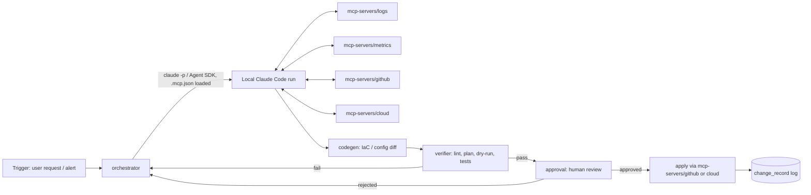

# AI DevOps Engineer Agent — Architecture

## Outcome this system moves

A daily-usable agent that takes a DevOps request in natural language (e.g. "the checkout service is throwing 500s, find out why and propose a fix" or "provision a staging Postgres instance") and produces a **verified, human-approved change** — IaC diff, config change, or remediation — with a trace of what it looked at and why. Measurable outcomes per phase are called out below; "it works" is not a phase-completion criterion.

## Correction to the original plan

Two things in the phase list you pasted need fixing before anything gets built, per your own global rules:

1. **LLM access.** Your CLAUDE.md rule is explicit: no OpenAI/Anthropic-API calls for agent reasoning — route through **local Claude Code**. Phases 2, 3, 5 as originally described (raw OpenAI API + Langchain) are out. See "LLM access" below for the replacement.
2. **"MCP" is Model Context Protocol**, not "Model-based Comms Protocol" — it's Anthropic's open standard for wiring an LLM client to external tools/data sources over a typed JSON-RPC interface. Claude Code is already an MCP client and can run its own agent loop against MCP servers. That changes the shape of Phases 2–4 substantially (next section).

## The real architectural decision — DECIDED: Option B

Claude Code is the agent runtime. It already provides a ReAct-style plan/act/observe loop, native MCP tool calling, subagents, hooks, permission gating, and skills. `orchestrator` drives it headlessly and owns only the DevOps-specific policy layer (what triggers a run, what gets logged, what needs human approval) rather than reimplementing a tool loop against a raw LLM API. Confirmed 2026-09-13.

## Confirmed invocation shape (verified against a live `claude --help` and two real headless runs, not guessed)

```
claude --print --output-format stream-json --verbose \
  --setting-sources project,local \
  --mcp-config <rendered .mcp.json> --strict-mcp-config \
  --permission-mode dontAsk --permission-prompts none \
  --no-session-persistence --max-budget-usd <cap> \
  --restricted \
  --system-prompt "<diagnostic-only persona>" \
  "<task description>"
```

Key flags and why:
- `--setting-sources project,local` — excludes the operator's personal `~/.claude/CLAUDE.md` and global rules from every run. Without this, a cold run pulls in ~18k tokens of irrelevant personal context (measured live) before it does anything DevOps-related. `--bare` would do this too but forces `ANTHROPIC_API_KEY` auth instead of the normal subscription session — wrong tradeoff here.
- `--strict-mcp-config` + `--mcp-config <rendered file>` — the run can only call the MCP servers `orchestrator` explicitly renders in for it, nothing from the operator's global MCP config.
- `--restricted` — strips Bash/PowerShell/code-execution tools and WebFetch. A diagnostic run has no business running shell commands; it only gets the registered MCP tools.
- `--permission-prompts none` — nothing can block waiting for a human in an unattended run; anything that would need a prompt is denied instead. Combined with `--restricted` and read-only MCP scopes, that's the actual safety boundary, not a permission dialog no one is watching.
- `--max-budget-usd` — hard spend cap per run, enforced by Claude Code itself (`terminal_reason: "budget_exhausted"` on a live test).
- `--model` intentionally omitted by default (`ClaudeRunConfig.model = None`) — let the account's configured default stand rather than hardcode a cheaper model. See `--model` docstring in `services/orchestrator/src/orchestrator/claude_runner.py`.
- `--output-format stream-json` over plain `json` — the single-result `json` mode only gives the final text and totals; `stream-json` also surfaces every `tool_use`/`tool_result` event, which `build_result()` turns into the audit-trail `ToolCall` list.

## Secrets never touch git or raw string interpolation

`.mcp.json.template` (committed) holds `${VAR}`-shaped placeholders only. `orchestrator.mcp_config.render_mcp_config()` parses it as JSON first, substitutes matching string *values* (not raw text) using a `SecretsProvider`, then re-serializes — a secret containing a quote or newline can't corrupt the config or inject a key. The rendered file is written to a temp path per run and is gitignored.

## Services-first layout

```
devops-agent/
  contracts/                    # shared schemas, versioned, both sides import — never reach into internals
    task_request.schema.json    # {id, description, requester, priority, created_at}
    tool_result.schema.json     # normalized shape every MCP tool server returns
    approval_request.schema.json
    change_record.schema.json   # what got proposed/applied, for audit + rollback
  services/
    orchestrator/                # owns policy: trigger -> Claude Code run -> approval -> apply
      src/
      tests/                     # gate: does it call the right MCP servers, enforce approval gate
      evals/                     # periodic: does the produced plan actually address the incident
      README.md
    mcp-servers/
      github/README.md            # registers github/github-mcp-server (official, read-only scoped) - no custom code
      cloud/README.md              # registers awslabs/mcp servers: cloudwatch, aws-iac (official) - no custom code
      logs/, metrics/, slack/       # build only when a concrete first use case needs them - see open question #2
    codegen/                     # Terraform/Dockerfile/config generation, invoked as a Claude Code skill or MCP tool
      tests/                     # gate: generated HCL/Dockerfile parses, lints clean
      evals/                     # periodic: generated IaC actually satisfies the request (LLM-judged)
    verifier/                    # static checks + test execution against generated changes before approval
      tests/
      evals/
    approval/                    # human approval workflow + audit log; the only service allowed to trigger apply
      tests/
    voice/                       # Phase 8, deferred — see "Deferred" section
  docs/
    ARCHITECTURE.md              # this file
  .mcp.json.template             # secret-free template; orchestrator renders real values in per-run
  scripts/                       # orchestration/glue only, no business logic
```

Each `services/*` directory is independently testable and independently deployable — two sessions can work in `mcp-servers/logs/` and `codegen/` without colliding, per your parallel-session rule.

## Data flow



## LLM access

`services/orchestrator` never calls an LLM API directly. It shells out to local Claude Code in headless `--print` mode with a rendered `.mcp.json` loaded, so Claude Code's own tool loop talks to your MCP servers directly — the orchestrator's job is choosing *when* to run, capturing the transcript for audit, and gating on `approval` before anything with side effects executes. Exact invocation flags are verified above, not guessed — see `services/orchestrator/src/orchestrator/claude_runner.py`.

## Phase mapping (original plan → this architecture)

| Original phase | Here |
|---|---|
| 1. Env setup | `services/orchestrator` + `mcp-servers/*` each get their own venv/deps, no shared global env |
| 2. ReAct loop | Provided by Claude Code itself (Option B) |
| 3. Agentic RAG | `mcp-servers/logs` + `mcp-servers/metrics` — Claude Code decides what to query, when, via native tool use |
| 4. MCP tool integration | `mcp-servers/github`, `mcp-servers/cloud`, `mcp-servers/slack` — real MCP servers, not custom adapters |
| 5. Codegen agent | `services/codegen`, invoked as a Claude Code skill/tool, not a separate OpenAI call |
| 6. Self-reflection/verification | `services/verifier` — deterministic lint/plan/test where possible (deterministic space), LLM-judged eval only where judgment is genuinely needed |
| 7. Human approval + deploy | `services/approval` — the only service with apply-time credentials |
| 8. Voice | Deferred — see below |

## Tests and evals (every service, no exceptions)

- **Gate tests** (free, <2s, pre-commit): schema validation for every MCP server's tool calls/responses against `contracts/`, codegen output lints/parses, orchestrator enforces the approval gate (unit test with a stub Claude Code run).
- **Periodic evals** (paid, nightly + pre-ship): does the agent's diagnosis match a labeled incident corpus, does generated IaC satisfy a rubric, judged by a Claude Code call — never a hosted API call for the judge either.

## Deferred: voice (Phase 8)

Lowest priority, no reason to design now. When it's time: OS-level STT/TTS (or a small local library) is enough for a wake-word + push-to-talk flow — no need for Alexa/Google Assistant platform lock-in for a personal DevOps tool.

## Decisions (2026-09-13)

1. **Option B confirmed** — Claude Code is the agent runtime.
2. **First tool integrations: GitHub + AWS cloud.** Logs/metrics next, Slack after that — build each when a concrete task actually needs it, not speculatively.
3. **Secrets** — production: a real secrets manager (Vault / AWS Secrets Manager / GCP Secret Manager), fetched just-in-time by `orchestrator`, never persisted by the agent. Local dev: env vars. Built now: the `SecretsProvider` protocol (`services/orchestrator/src/orchestrator/secrets.py`) and `EnvSecretsProvider` for local dev. **Not built yet**: a Vault/Secrets-Manager-backed implementation — there's no production deployment target to point it at yet, so it would be a speculative stub. Implement it against the same protocol when you pick a deployment target; that's a same-session addition, not a redesign.

## Phase 1 MVP — built (this repo, 2026-09-13)

- `contracts/` — 4 JSON schemas + `validate()`, 11 tests.
- `services/orchestrator/` — `SubprocessClaudeRunner` (verified CLI invocation, see above), `render_mcp_config` (safe secret substitution), `run_task()` (task → diagnostic Claude Code run → pending `ApprovalRequest`, never applies), 37 tests, all using a fake runner — no live LLM calls in the gate suite.
- `services/approval/` — `ApprovalStore` (append-only, enforces pending→decided exactly once) and `ChangeLog` audit trail, 10 tests.
- `.mcp.json.template` + READMEs registering the official `github-mcp-server` and two `awslabs/mcp` servers (`cloudwatch`, `aws-iac`) — no custom MCP server code written, per "search before building."
- 48 gate tests total, <1s, wired to a pre-commit hook (`git config core.hooksPath scripts/hooks`, done by `scripts/setup.sh`).

## Explicitly not built yet (next real increment, not this one)

- **Apply.** `services/approval` has no code path that actually calls GitHub or AWS with write access. Build this against the first real approved task, not speculatively — "revert a commit" and "resize an RDS instance" don't share a shape, and guessing now means rewriting later.
- **`services/verifier`, `services/codegen`.** Same reasoning — no concrete IaC-generation or pre-apply-verification use case exists yet to build these against.
- **Vault/Secrets Manager integration.** See decision #3 above.
- **Voice (Phase 8).** Explicitly deferred in the original doc section below; nothing changed that.
