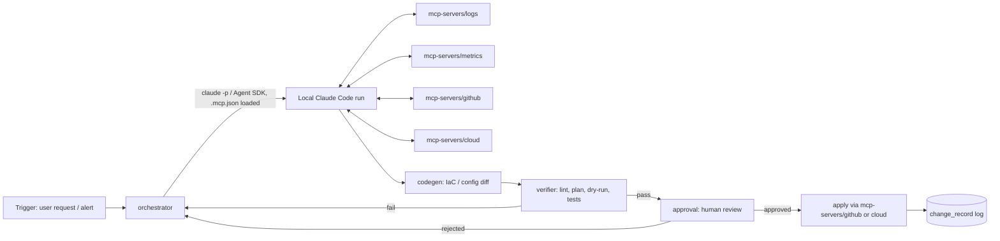

# AI DevOps Engineer Agent — Architecture

## Outcome this system moves

A daily-usable agent that takes a DevOps request in natural language (e.g. "the checkout service is throwing 500s, find out why and propose a fix" or "provision a staging Postgres instance") and produces a **verified, human-approved change** — IaC diff, config change, or remediation — with a trace of what it looked at and why. Measurable outcomes per phase are called out below; "it works" is not a phase-completion criterion.

## Correction to the original plan

Two things in the phase list you pasted need fixing before anything gets built, per your own global rules:

1. **LLM access.** Your CLAUDE.md rule is explicit: no OpenAI/Anthropic-API calls for agent reasoning — route through **local Claude Code**. Phases 2, 3, 5 as originally described (raw OpenAI API + Langchain) are out. See "LLM access" below for the replacement.
2. **"MCP" is Model Context Protocol**, not "Model-based Comms Protocol" — it's Anthropic's open standard for wiring an LLM client to external tools/data sources over a typed JSON-RPC interface. Claude Code is already an MCP client and can run its own agent loop against MCP servers. That changes the shape of Phases 2–4 substantially (next section).

## The real architectural decision

This is a genuine fork — pick one before any code gets written:

**Option A — Reimplement the agent loop.** Build a custom ReAct loop, planner, and tool-dispatch layer that calls the local Claude Code binary as a "dumb" text-completion backend (one-shot prompts in, text out), the way the original plan called OpenAI.

**Option B — Claude Code *is* the agent runtime (recommended).** Claude Code already provides: a ReAct-style plan/act/observe loop, native MCP tool calling, subagents, hooks, permission gating, and skills. Instead of rebuilding that, you:
- Write your DevOps tools (log search, metrics query, GitHub, AWS, Slack) as **MCP servers** — small, testable, independently deployable — and register them with Claude Code via `.mcp.json`.
- Drive Claude Code **headlessly** for the "agent" use case, either via `claude -p "<task>" --output-format stream-json` or the Claude Agent SDK (Python/TypeScript), from a thin orchestrator service that owns the DevOps-specific policy: what triggers a run, what gets logged, what needs human approval before it's allowed to execute.
- Get Phases 2–4 of the original plan (ReAct loop, RAG-style retrieval, tool integration) essentially for free, and spend your engineering effort on the parts that are actually DevOps-specific: the MCP tool servers, the verification/approval gate, and IaC generation quality.

Option B is less total code, less to maintain, and matches the "search before building — Layer 1: is there a standard tool that does this" rule directly: Claude Code + MCP *is* the tried-and-true layer here, not a library you'd pull off GitHub.

**I'm building the rest of this doc around Option B.** If you want Option A instead (e.g. because this needs to run without Claude Code installed, or needs a different LLM at some point), say so and the service boundaries below change.

## Services-first layout

```
devops-agent/
  contracts/                    # shared schemas, versioned, both sides import — never reach into internals
    task_request.schema.json    # {id, description, requester, priority, created_at}
    tool_result.schema.json     # normalized shape every MCP tool server returns
    approval_request.schema.json
    change_record.schema.json   # what got proposed/applied, for audit + rollback
  services/
    orchestrator/                # owns policy: trigger -> Claude Code run -> approval -> apply
      src/
      tests/                     # gate: does it call the right MCP servers, enforce approval gate
      evals/                     # periodic: does the produced plan actually address the incident
      README.md
    mcp-servers/
      logs/                      # MCP server: search app/infra logs
      metrics/                   # MCP server: query Prometheus/Grafana/Datadog etc.
      github/                    # MCP server: PRs, issues, repo state
      cloud/                     # MCP server: read-only cloud resource state (AWS/GCP/Azure)
      slack/                     # MCP server: post updates, ask for approval
      each with: src/, tests/, evals/, README.md, its own schema in contracts/
    codegen/                     # Terraform/Dockerfile/config generation, invoked as a Claude Code skill or MCP tool
      tests/                     # gate: generated HCL/Dockerfile parses, lints clean
      evals/                     # periodic: generated IaC actually satisfies the request (LLM-judged)
    verifier/                    # static checks + test execution against generated changes before approval
      tests/
      evals/
    approval/                    # human approval workflow + audit log; the only service allowed to trigger apply
      tests/
    voice/                       # Phase 8, deferred — see "Deferred" section
  docs/
    ARCHITECTURE.md              # this file
  .mcp.json                      # registers services/mcp-servers/* with Claude Code
  scripts/                       # orchestration/glue only, no business logic
```

Each `services/*` directory is independently testable and independently deployable — two sessions can work in `mcp-servers/logs/` and `codegen/` without colliding, per your parallel-session rule.

## Data flow



## LLM access

`services/orchestrator` never calls an LLM API directly. It shells out to local Claude Code (headless `-p` mode or the Claude Agent SDK) with `.mcp.json` loaded, so Claude Code's own tool loop talks to your MCP servers directly — the orchestrator's job is choosing *when* to run, capturing the transcript for audit, and gating on `approval` before anything with side effects executes. Exact SDK/CLI invocation flags should be confirmed against current Claude Code docs at implementation time (pull in the `claude-code-guide` agent for that — don't guess flag names here).

## Phase mapping (original plan → this architecture)

| Original phase | Here |
|---|---|
| 1. Env setup | `services/orchestrator` + `mcp-servers/*` each get their own venv/deps, no shared global env |
| 2. ReAct loop | Provided by Claude Code itself (Option B) |
| 3. Agentic RAG | `mcp-servers/logs` + `mcp-servers/metrics` — Claude Code decides what to query, when, via native tool use |
| 4. MCP tool integration | `mcp-servers/github`, `mcp-servers/cloud`, `mcp-servers/slack` — real MCP servers, not custom adapters |
| 5. Codegen agent | `services/codegen`, invoked as a Claude Code skill/tool, not a separate OpenAI call |
| 6. Self-reflection/verification | `services/verifier` — deterministic lint/plan/test where possible (deterministic space), LLM-judged eval only where judgment is genuinely needed |
| 7. Human approval + deploy | `services/approval` — the only service with apply-time credentials |
| 8. Voice | Deferred — see below |

## Tests and evals (every service, no exceptions)

- **Gate tests** (free, <2s, pre-commit): schema validation for every MCP server's tool calls/responses against `contracts/`, codegen output lints/parses, orchestrator enforces the approval gate (unit test with a stub Claude Code run).
- **Periodic evals** (paid, nightly + pre-ship): does the agent's diagnosis match a labeled incident corpus, does generated IaC satisfy a rubric, judged by a Claude Code call — never a hosted API call for the judge either.

## Deferred: voice (Phase 8)

Lowest priority, no reason to design now. When it's time: OS-level STT/TTS (or a small local library) is enough for a wake-word + push-to-talk flow — no need for Alexa/Google Assistant platform lock-in for a personal DevOps tool.

## Open questions (need your call before implementation starts)

1. **Option A vs B above** — confirm Option B (Claude Code as runtime) or say why you need A.
2. **Which tools first?** Original plan says GitHub, AWS, Gmail, Slack. Building all four MCP servers in parallel is fine (services-first, fan out), but which one is the actual daily pain point you want solved first — that's the one to build and eval against real usage, not the others.
3. **Apply-time credentials** — `services/approval` will hold real write-access credentials (cloud, GitHub). Where do those live (env vars per your API rules, a secrets manager)? Not deciding this before implementation means it gets decided badly under time pressure.

## Next step

Once you've answered the three questions above, Phase 1 (env scaffolding for `orchestrator` + one MCP server) is a same-session build with tests in the diff, per your own "ship the complete thing" rule.
